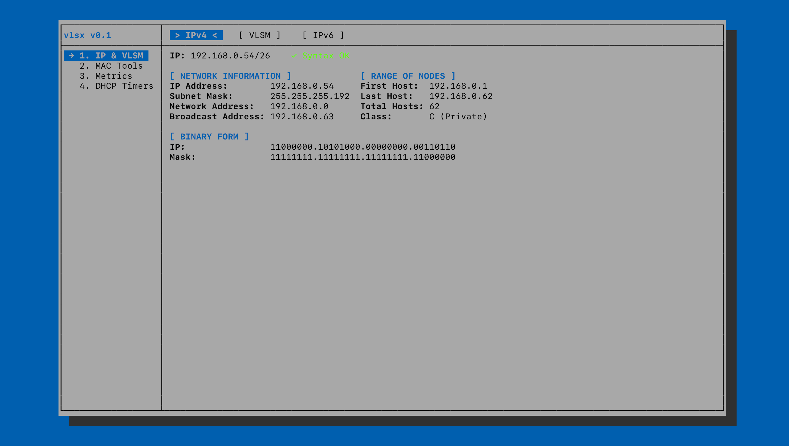

<h3 align="center">vlsx</h3>

<p align="center">
  <strong>
    A lightweight terminal toolkit for network engineers: IPv4/IPv6 subnetting,
    VLSM planning, MAC analysis, SLA metrics, and DHCP timers in one TUI.
  </strong>
</p>
<p align="center">
  <a href="https://github.com/b1sted/vlsx/actions/workflows/test.yml">
    
  </a>
  <a href="https://github.com/b1sted/vlsx/releases/latest">
    
  </a>
  <a href="https://github.com/b1sted/homebrew-tap">
    
  </a>
  <a href="#license">
    
  </a>
</p>
<p align="center">
  <a href="#features">Features</a> •
  <a href="#installation">Installation</a> •
  <a href="#modules">Modules</a> •
  <a href="#controls">Controls</a> •
  <a href="#build-and-run">Build and run</a> •
  <a href="#architecture">Architecture</a> •
  <a href="#cicd">CI/CD</a> •
  <a href="#license">License</a>
</p>
<hr>

`vlsx` is a keyboard-driven terminal application for everyday network calculations.
It is written in C99, keeps all calculator logic independent of the UI, and ships
with a vendored copy of [termbox2](https://github.com/termbox/termbox2), so it has
no runtime dependencies beyond a POSIX terminal.

<br>
<p align="center">
  
  <br>
  <em>vlsx v0.1</em>
</p>
<br>

## Features

- **IPv4 subnet calculator**: network and broadcast addresses, usable host range,
  host count, address class, and binary representation from a single CIDR input.
- **VLSM planner**: allocate up to 16 subnets from a base network using
  comma-separated host requirements. Subnets are sorted largest first and the
  unused capacity is reported.
- **IPv6 calculator**: validate and format IPv6 addresses, show compressed and
  expanded forms, derive the network prefix and interface ID, and classify the
  address type.
- **MAC analyzer**: parse colon, hyphen, Cisco, and raw MAC formats; report the
  OUI and NIC parts, cast and administration bits, and Linux/Windows, Cisco, and
  binary representations.
- **Multicast MAC generator**: map any IPv4 multicast address in `224.0.0.0/4`
  to its Ethernet multicast MAC and show each step of the 23-bit mapping.
- **SLA and performance metrics**: availability from uptime and downtime,
  allowed downtime for 99.99% and 99.999% targets, and effective goodput after
  protocol overhead.
- **Network cost planning**: sum CapEx and OpEx line items and show the totals.
- **DHCPv4 timers**: derive the T0, T1, and T2 lease timers from a lease time in
  minutes.
- **Zero dependencies**: only libc, POSIX, and the vendored single-header
  `third_party/termbox2.h`.

## Installation

### Homebrew (macOS & Linux)

```bash
brew install b1sted/tap/vlsx
```

The tap tracks the latest stable release and builds it from source for the
current platform.

### Linux packages

Native packages for `amd64`, `arm64`, `armv7`, and `riscv64` are attached to
every [GitHub Release](https://github.com/b1sted/vlsx/releases). Download the
package for your distribution and install it locally:

```bash
# Debian / Ubuntu
sudo apt install ./vlsx_0.1.2_*.deb

# Fedora / RHEL / openSUSE
sudo dnf install ./vlsx-0.1.2.*.rpm

# Arch Linux
sudo pacman -U ./vlsx-0.1.2-*.pkg.tar.zst
```

### Android (Termux)

The release ships native Termux `.deb` packages for `aarch64`, `arm`, and
`x86_64`. They use a `vlsx-termux_` filename prefix so they are not confused
with the native Linux packages:

```bash
pkg install ./vlsx-termux_0.1.2_*.deb
```

### Prebuilt binaries (`.tar.gz`)

Standalone archives are published for Linux (`amd64`, `arm64`, `armv7`,
`riscv64`, and Luckfox ARM), Android/Termux, and macOS (`arm64`, Intel modern,
and Intel legacy). Download the archive for your platform, unpack it, and move
`vlsx` onto your `PATH`:

```bash
tar -xzf vlsx-linux-amd64.tar.gz
sudo install -m 0755 vlsx /usr/local/bin/vlsx
```

> [!NOTE]
> macOS marks binaries downloaded through a browser as quarantined. Remove the
> attribute before the first run:
>
> ```bash
> xattr -d com.apple.quarantine ./vlsx
> ```

### Verification

Every release publishes checksums, a GPG signature, and build provenance.
Verify the downloaded files with any of the following methods:

```bash
# SHA256 checksums
sha256sum -c SHA256SUMS.txt --ignore-missing

# GPG signature
curl -fsSL https://github.com/b1sted.gpg | gpg --import && \
  gpg --verify SHA256SUMS.txt.asc SHA256SUMS.txt

# GitHub build attestation
gh attestation verify vlsx-linux-amd64.tar.gz --repo b1sted/vlsx
```

## Modules

The application is split into four top-level modules. Each module has tabs that
are selected with the arrow keys, `Tab`, or the number keys.

| Module | Tabs | Input | Output |
| --- | --- | --- | --- |
| **IP & VLSM** | IPv4, VLSM, IPv6 | CIDR notation and host requirements | Subnet details, allocation plan, or IPv6 formatting |
| **MAC Tools** | Converter, Multicast MAC | A MAC address or an IPv4 multicast address | Address structure and bit analysis, or the generated multicast MAC |
| **Metrics** | Availability, Goodput, Costs | Uptime/downtime, bandwidth/overhead, or cost lists | Availability and downtime budgets, goodput, or totals |
| **DHCP Timers** | DHCPv4 | Lease time in minutes | T0, T1, and T2 renewal timers |

### IPv4 calculator

Enter an IPv4 address with a prefix, for example `192.168.0.54/26`. The screen
reports:

- subnet mask, network address, and broadcast address;
- first and last usable host, host count, and address class;
- the IP address and mask in binary.

`/31` point-to-point links and `/32` host routes are handled as special cases;
fields that do not apply are shown as `N/A` or `N/A (RFC 3021)` and the host
count is adjusted.

### VLSM planner

Enter a base network in CIDR notation and a comma-separated list of required
host counts, for example `192.168.0.0/24` and `100, 50, 20`. The planner:

- sorts requirements from largest to smallest;
- allocates the smallest prefix that satisfies each requirement;
- shows the requested and allocated host counts, prefix, network, broadcast,
  and host range for every subnet;
- summarizes the base capacity, allocated hosts, unallocated hosts, and
  utilization percentage.

Up to 16 subnets can be planned. Requirements that do not fit into the base
network, or a list longer than the table can hold, produce a validation error
instead of a partial result.

### IPv6 calculator

Enter an address with a prefix, for example `2001:db8::1/64`. The screen shows:

- the original input, the form without leading zeros, the compressed form, and
  the fully expanded form;
- the prefix length, network prefix, and interface ID;
- the address type, such as loopback, link-local, unique-local, multicast,
  documentation, 6to4, Teredo, or global unicast.

### MAC analyzer

The converter accepts the following formats:

```text
F4:46:37:55:24:86
F4-46-37-55-24-86
F446.3755.2486
F44637552486
```

For `F4:46:37:55:24:86` it reports the OUI (`F4:46:37`), NIC part
(`55:24:86`), cast type, administration type, Linux/Windows
(`F4:46:37:55:24:86`) and Cisco (`f446.3755.2486`) formats, the full binary
representation, and the bit analysis of the first octet. Bit 0 selects unicast
or multicast; bit 1 selects universally or locally administered addresses.

### Multicast MAC generator

Enter an IPv4 multicast address such as `239.1.1.15`. The generator combines the
fixed `01:00:5E` OUI with the lower 23 bits of the IPv4 address, producing
`01:00:5E:01:01:0F`, and displays the binary IP, the extracted bits, and the
merged result.

### Availability, goodput, and costs

| Tab | Example input | Result |
| --- | --- | --- |
| **Availability** | uptime `8760` hours, downtime `2` hours | `99.977%` availability; allowed downtime of `52.56` minutes/year at 99.99% and `5.256` minutes/year at 99.999% |
| **Goodput** | bandwidth `100` Mbps, overhead `15`% | nominal `100.00` Mbps, overhead `15.00` Mbps, goodput `85.00` Mbps |
| **Costs** | CapEx `5000, 200, 1000`, OpEx `100, 50, 20` | CapEx `$6200.00`, OpEx `$170.00`, total `$6370.00` |

Cost lists accept positive decimal values separated by commas.

### DHCPv4 timers

Enter a lease time in whole minutes. For a `600` minute lease the screen shows:

| Timer | Value | Meaning |
| --- | --- | --- |
| **T0** | `300` minutes (50%) | Unicast `DHCPREQUEST` to the original server |
| **T1** | `525` minutes (87.5%) | Broadcast `DHCPREQUEST` to any server |
| **T2** | `600` minutes (100%) | Lease expires; the client restarts DORA |

## Controls

The interface needs a terminal of at least **90x24** characters. Resizing the
terminal redraws the layout automatically.

| Key | Action |
| --- | --- |
| `↑` / `↓` | Move the sidebar selection; switch fields in a form |
| `←` / `→` | Switch tabs when the tab bar is focused; move the cursor inside an input |
| `Enter` | Open the selected module or calculate the current form |
| `Tab` | Cycle through the tabs of the current module |
| `1`–`9` | Jump directly to a tab while the tab bar is focused |
| `Esc` | Leave the input, return to the previous screen, or quit from the main menu |
| `q` | Quit from the navigation screens; leave a VLSM field with `Esc` first |
| `Ctrl-U` | Clear the active input field |
| `Ctrl-A` / `Ctrl-E` | Move the cursor to the start or end of the active input |
| `h` / `j` / `k` / `l` | Scroll the VLSM table left, down, up, and right while it is displayed |

The active input field is marked with a block cursor. `↑` / `↓` keep switching
fields after a result is calculated; the VLSM table is scrolled with
`h` / `j` / `k` / `l`.

Invalid input never leaves a stale result on screen: the previous result is
cleared and a specific validation message is shown instead.

## Build and run

### Requirements

- a C99 compiler (`gcc` or `clang`);
- GNU `make`;
- a POSIX terminal.

The build supports Linux, macOS, and Android/Termux. `termbox2` is vendored, so
there is no package to install for the UI.

### Compilation

```bash
git clone https://github.com/b1sted/vlsx.git
cd vlsx
make
```

The release binary is written to `bin/vlsx`:

```bash
./bin/vlsx
```

### Make targets

| Target | Purpose |
| --- | --- |
| `make` | Build the optimized release binary in `bin/vlsx`; also runs the layer checks |
| `make dev` | Build the debug binary in `bin/vlsx-dev` |
| `make leaks` | Build `bin/vlsx-leaks` with AddressSanitizer and UndefinedBehaviorSanitizer |
| `make test` | Build and run the core unit test suite |
| `make check-layers` | Verify the architecture boundaries without building the UI |
| `make clean` | Remove `bin/` and `obj/` |

The project builds with a strict warning set and `-Werror`; a warning is treated
as a build failure. For interactive sanitizer checks, run `make leaks` and
exercise the affected screen in `./bin/vlsx-leaks`.

### Testing

The unit tests cover the pure `core/` and `common/` layers and do not link the
TUI, screens, or `termbox2`:

```bash
make test
```

Add a regression test in `tests/` whenever calculation behavior changes,
including boundary values, invalid input, and capacity failures.

## Architecture

```text
src/
├── app/         application state, event dispatch, menus, and routing
├── common/      shared input fields, DFA helpers, results, and utilities
├── core/        pure networking calculations (no UI dependencies)
│   └── net/     ipv4, ipv6, vlsm, mac, sla, and dhcp modules
├── screens/     per-screen input controllers and validation
├── tui/         termbox2 backend, layout, chrome, tables, and views
└── main.c       terminal setup and the event loop
include/         public headers mirroring the source tree
tests/           unit tests for core and common
third_party/     vendored termbox2
```

The dependency direction is enforced by `make check-layers`:

- `core/` and `common/` never include or call `app`, screens, or TUI code;
- only `tui/` may include `termbox2.h` or use `tb_*` functions;
- screens and the application layer stay independent of termbox2;
- `TB_IMPL` is defined exactly once.

Calculation results are stored in plain result structures, so the same core
functions can be reused outside the TUI.

## CI/CD

The GitHub Actions workflows are deliberately path-filtered and scoped so that
documentation-only commits do not occupy a runner.

### CI

`.github/workflows/test.yml` (`Test, Leak & Lint`) runs:

- on pull requests targeting `main` or `dev`;
- on pushes to `main`;
- manually through `workflow_dispatch`;
- only when source, headers, tests, `third_party/`, the `Makefile`, or the
  clang-format configuration change.

A concurrency group cancels an older run for the same ref when a newer commit
arrives. The build matrix covers GCC and Clang on Ubuntu and Clang on macOS.
Additional jobs run the core tests with AddressSanitizer and
UndefinedBehaviorSanitizer, check formatting with `clang-format`, and run
`cppcheck`.

### Releases

`.github/workflows/release.yml` runs when a tag matching `v*.*` or `v*.*.*` is
pushed. Testing, leak checks, and linting live in `.github/workflows/test.yml`,
which runs on pull requests and pushes to `main`. The release workflow calls the
same workflow with `workflow_call` before any build starts, so a tag cannot be
published unless those checks pass. It then builds and smoke-tests:

- Linux: amd64, arm64, armv7, riscv64, and Luckfox ARM;
- Android/Termux: aarch64, armv7, and x86_64;
- macOS: Apple Silicon, Intel legacy (10.7), and Intel modern (10.9).

The release publishes `.tar.gz` archives, `deb`/`rpm`/Arch Linux packages for
Linux, Termux `.deb` packages named `vlsx-termux_*`, a GPG-signed
`SHA256SUMS.txt`, GitHub build provenance attestations, and an updated Homebrew
tap formula. Tags containing a hyphen, such as `v0.2.0-rc1`, are marked as
prereleases.

### Local checks

Run the same important checks before opening a pull request:

```bash
make
make test
find src include tests -type f \( -name '*.c' -o -name '*.h' \) -print0 \
  | xargs -0 clang-format --dry-run --Werror
cppcheck --enable=warning,performance,portability \
  --error-exitcode=1 --suppress=missingIncludeSystem \
  --suppress='*:*third_party/*' -Iinclude -Ithird_party src tests
```

## Contributing

Follow [STYLEGUIDE.md](./STYLEGUIDE.md) for the architecture, C99 style, and
quality gates. Commit messages use the Conventional Commits format
(`feat:`, `fix:`, `docs:`, `ci:`, and so on) and are written in English.

## License

Distributed under the **GNU GPL v3.0 or later** (`GPL-3.0-or-later`).

You are free to use, modify, distribute, and sell this software. Derivative
works must be distributed under the same license, the source code must remain
available, and the copyright notice and license file must be preserved.

Full text of the license: [LICENSE](./LICENSE).
